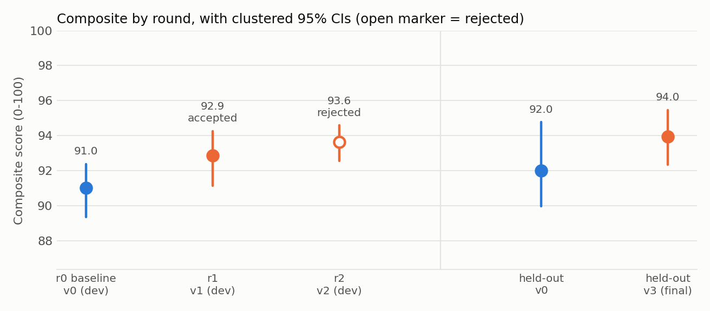
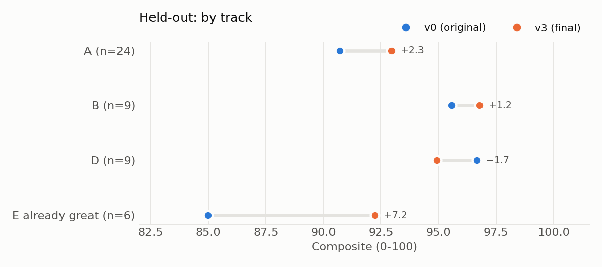
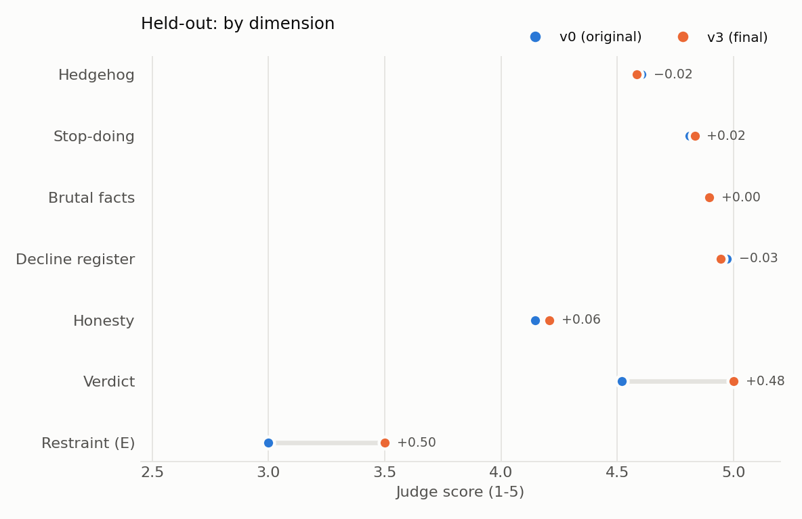

# Report: evaluating and improving `good-to-great-anything`

The final skill is [deliverable/SKILL.md](deliverable/SKILL.md), and its diff against the original is [deliverable/SKILL.diff](deliverable/SKILL.diff). It is published separately in **[good-to-great-anything](https://github.com/KShervington/good-to-great-anything)**. All numbers below come from `runs/decisions/*.json`, which `scripts/final_eval.py` and `analyze.py` produce.

## Bottom line

- **The final skill (v3) scored +1.9 points over the original on the 16 held-out cases: 93.95 vs 92.02 out of 100.**
  - That is in line with the dev gains: +1.9 in round 1 and +0.7 in round 2.
  - The 95% CI is [−0.9, +4.0] (clustered bootstrap, 10 company clusters, 48 paired outputs). It includes zero, so **the held-out set alone doesn't confirm the gain**.
  - v3 beat the original in 92% of bootstrap resamples, 5 clusters improved and 4 got worse.
- **The gains are concentrated in three behaviors, and each has direct evidence:**
  1. **A short verdict.** D8 went from 4.52 to 5.00 on held-out (dev: 4.48 to 4.98), and in the held-out A/B comparison v3 won the verdict 24 times to 5.
  2. **Recognizing an already-great company and holding back (Track E).** Held-out composite went from 85.0 to 92.2 and restraint (D9) from 3.0 to 3.5. On dev, the share of already-great outputs that say so went from 3/15 to 12–13/15.
  3. **Correct Gate 1 calls on dev.** The not-yet-good startup now fails Gate 1 and the once-good company in crisis is treated as a turnaround. The Gate 0/1 call was right in 126/126 outputs (v0: 121/126). There are no held-out cases of this kind, see the limits section.
- **Nothing improved across the board.** In the held-out A/B comparison the judge preferred the original 25 times and v3 23 times. v3's big wins on the verdict are offset by small losses on the decline register (D5: 6 wins vs 11) and stop-doing (13 vs 17).
- **My read:** v3 is a modest, low-risk improvement on the skill's known weak spots: a long verdict, blindness to already-great subjects, and hedged Gate 1 calls. It is not a better strategist in general. On hedgehog quality, stop-doing and brutal facts, the original was already near the ceiling (4.6–4.9 out of 5), and it stayed there.

## Composite by round

Each dot is the mean composite with a clustered 95% CI for that version's own mean. The accept decisions used the *paired* difference, which is tighter.

| Round | Split | Candidate vs baseline | Candidate | Baseline | Diff [95% CI] | Decision |
|---|---|---|---|---|---|---|
| r0 | dev (42 cases × 3 seeds) | v0 baseline | — | 91.01 | — | baseline |
| r1 | dev | v1 vs v0 | 92.88 | 91.01 | +1.87 [+0.98, +2.79] | **accept** (below the 2.0 stop threshold) |
| r2 | dev | v2 vs v1 | 93.63 | 92.88 | +0.74 [−0.23, +1.92] | **reject** (CI includes 0), so the loop stops |
| — | — | v3 = v2 with E6 removed | — | — | — | final candidate, chosen by you before any held-out result existed |
| final | held-out (16 cases × 3 seeds) | v3 vs v0 | 93.95 | 92.02 | +1.94 [−0.86, +3.96] | reported, not gated |

All composites are recomputed with the final scorer. Round 1's scorer fixes, which apply to every version equally, raised v0's dev baseline from 90.7 to 91.0. v3 was never run on dev as a whole: its parts were each tested there, in v1 (Gate 10 wording) and v2 (E4, E5).

## Held-out results (v0 vs v3)

### By track

| Track | Cases | v0 | v3 | Δ |
|---|---|---|---|---|
| A: Collins great companies and comparisons (incl. unsustained) | 8 | 90.7 | 93.0 | +2.3 |
| B: fallen great companies, judged at their peak | 3 | 95.6 | 96.8 | +1.2 |
| D: synthetic subjects | 3 | 96.7 | 94.9 | −1.7 |
| E: already-great controls | 2 | 85.0 | 92.2 | +7.2 |

- The held-out set has no Track C case, no Gate 0/1 failure case and no "already great but drifting" case: dev needed all of those. On dev, v2 (the closest tested version to v3) moved them as follows:
  - Track C from 84.1 to 88.9.
  - The drifting E case from 91.4 to 96.2.
  - Gate 0/1 calls from 121 to 126 correct out of 126.
- **Track D's dip** comes from two cases, D07 (−2.1) and D08 (−3.2). It is scattered single-point drops on stop-doing, decline register, hedgehog and honesty, with no pattern I can link to an edit. On dev, Track D rose from 92.3 to 95.7 (v2). This is most likely noise on 9 outputs, but it isn't proven to be noise.
- **Track E:**
  - E01 (a steel minimill) is now run in stewardship mode in 3/3 seeds, against 0/3 before, with D9 rising from 3 to 4.
  - E05 (a consumer-brands company facing a tempting acquisition) is still called "good and close to great" in 3/3, with D9 at 3. That is an honest miss: v3 refuses the acquisition, which is the right call, but it doesn't say the company is already great.
- **Track B:** v3 calls B06 "already great, now drifting" in 3/3 seeds. For a fallen company judged at its peak, that is the correct reading, and Track B's composite rose.

### By dimension

| Dimension | v0 | v3 | A/B wins (v3 / v0 / tie) |
|---|---|---|---|
| D1 Hedgehog match | 4.60 | 4.58 | 15 / 14 / 19 |
| D2 Stop-doing includes the real decision | 4.81 | 4.83 | 13 / 17 / 18 |
| D3 Brutal facts found | 4.90 | 4.90 | 5 / 7 / 36 |
| D5 Decline risk flagged | 4.97 | 4.94 | 6 / 11 / 17 |
| D7 Calibration and honesty | 4.15 | 4.21 | 12 / 11 / 25 |
| D8 One-screen verdict | 4.52 | **5.00** | **24 / 5 / 19** |
| D9 Restraint (Track E only) | 3.00 | 3.50 | 6 / 0 / 0 |
| D6 Gate 0/1 call correct (deterministic) | 48/48 | 48/48 | — |
| D4 AUROC, greatness potential (Tracks A/C/D) | 0.94 | 0.95 | — |

E5's honesty gain on dev (A/B 69 vs 22 against v1) shows up only weakly on held-out: absolute D7 +0.06, A/B 12 vs 11. On dev, v1's honesty *loss* against v0 (19 vs 58) and v2's recovery largely cancel, so v3's net honesty effect against the original is about neutral. That fits the held-out result.

### Recognizable vs not recognizable

The skill model recognized every real company from its anonymized dossier (44/44 probes), so "not recognizable" means the synthetic cases (Track D, plus synthetic Track E in dev).

| Split | Group | Outputs | v0 | Final | Δ |
|---|---|---|---|---|---|
| held-out | recognizable | 39 | 90.9 | 93.7 | +2.8 |
| held-out | not recognizable | 9 | 96.7 | 94.9 | −1.7 |
| dev | recognizable | 93 | 90.7 | 92.9 (v2) | +2.2 |
| dev | not recognizable | 33 | 91.9 | 95.6 (v2) | +3.7 |

On dev the gain is larger on synthetic cases. On held-out it is reversed, on only 3 synthetic cases. Neither split shows the gain depending on whether the model recognizes the company. There were no hindsight leaks (the output using facts from after the dossier date) in any held-out output.

### Deterministic checks (held-out)

| Check | v0 | v3 |
|---|---|---|
| Required sections | 48/48 | 48/48 |
| Gate count and order | 47/48 | 48/48 |
| Stop-doing at least 5 items (waived in stewardship mode) | 42/42 | 40/42 |
| Hedgehog in one sentence | 45/48 | 45/48 |
| `[ASSUMPTION]` tagging (reported only) | 29/48 | 27/48 |
| No long Collins quote | 48/48 | 48/48 |

## What changed and why

Three edits from round 1 and two from round 2 are in the final skill. One edit was tried and removed. Each was aimed at a failure cluster found in v0's dev outputs.

| Edit | What it does | Why (failure seen) | Evidence it worked |
|---|---|---|---|
| **E1 three-state Gate 1 with stewardship mode** (r1) | Adds an "already great" state. In it, Gate 5 confirms the existing hedgehog, Gate 6 lists only real temptations, recommendations are few, and Gate 10 is the center. The principle line gets a matching exception. | D9 ≤ 3 in 7/15 Track E outputs. The skill never said "already great" and listed 7–9 stop-doing items for companies at their peak. | Dev D9 3.53 → 4.33, and Track E outputs saying so went from 3/15 to 13/15. Held-out Track E composite +7.2. |
| **E2 firm FAIL for not-yet-good** (r1) | Gives concrete signs of "not yet good" and says "don't soften to CONDITIONAL". | D05 (a startup carried by its founder's network) got CONDITIONAL in 3/3, used as a hedge. | D05 fails Gate 1 in 3/3. |
| **E3 short verdict** (r1) | Keeps the verdict under about 150 words and moves rationale, tallies and notes to the gate log. | D8 = 4 in 69/126: verdicts padded with scoring rationale and method notes. | D8 4.48 → 4.96 (dev) and 4.52 → 5.00 (held-out). |
| **E4 turnaround ≠ not-yet-good** (r2) | Reserves "not yet good" for a core that never worked. A once-good subject in crisis is run as a turnaround, brutal facts first. | E2 overshot: v1 failed A24 (a once-good carmaker in crisis) in 3/3. | A24 Gate 1 went from 0/3 to 3/3 correct, and D6 reached 126/126 on dev. |
| **E5 honesty kept in the short verdict** (r2) | Adds one line on how confident the verdict is and what it rests on, and keeps `[ASSUMPTION]` tags. | E3 trimmed confidence statements and tags: A/B honesty v0 58 vs v1 19. | A/B honesty v2 69 vs v1 22 (dev). It is neutral against v0 on held-out. |
| ~~E6 lead with the one or two decline mechanisms~~ (r2, **removed**) | Gate 10 leads with the most likely mechanisms, each with a warning sign and a trigger threshold. | D5 = 3 in 12 outputs: a boilerplate walk through all five stages. | **Didn't work.** A/B decline register v1 35 vs v2 29. It caused v2's largest losses (A17 D5 5 → 2), because the narrowing missed the mechanism the answer key expects. Gate 10 is back to the original wording. |

There are no company names, case facts or answer-key content in the skill. `analyze.overfit_scan` was clean for every version. The final skill is 2,766 words, +11.6% over the original (the cap was +20%).

## Departures from the plan, stated plainly

1. **v3 was chosen by you, not by the accept rule.** v2 failed the accept rule (its CI included 0). After seeing that its two fixes had strong direct evidence and E6 didn't, you chose to keep v2 without E6 and go straight to held-out. This was decided and committed (`8d3b1d3`) before any held-out output existed, so the held-out result is still an unbiased test of v3. But v3 as a whole was never run on dev.
2. **Human calibration was replaced by an automated judge check** (your decision). The judge passed all 31 checks:
   - It agreed with itself within 1 point on 71/71 dimension scores, and 89% were identical.
   - It caught a swapped answer key, fabricated metrics, a removed verdict, a removed stop-doing list, and bad advice to an already-great company, each time.
3. **Scorer fixes after the baseline** applied to every version alike, and are logged in CHANGELOG.md:
   - A run that correctly stops at a failed Gate 0/1 is no longer penalized for the sections it skips.
   - Stewardship headings count as the stop-doing section.
   - D9 is scored on Track E only.
   - The `[ASSUMPTION]` regex is reported only.
4. **The loop ran 2 rounds, not more.** The stop rule (two rounds in a row each under 2 points) triggered after round 2.

## Limit pauses and time

| When | Model limit | Paused | Note |
|---|---|---|---|
| 2026-11-24 01:07 → 08:37 | Opus and Fable at once (a shared session limit; reset 01:50) | 7.5 h | The PC slept from 01:20 to 08:37, so 6.75 h of this was sleep, not the limit. The harness now keeps Windows awake while work remains. |
| 2026-11-25 00:48 → 01:32 | Fable | 0.7 h | Resumed on its own 2 min after the reset. |

- **Total wall-clock time paused:** 8.2 h, with overlapping Opus/Fable pauses counted once. Round 2 and the held-out run had no pauses.
- **No job was lost or duplicated:** 1,337 jobs, 0 real failures.
- **Cost:** $384 API-equivalent in total.
  - Baseline: $77.
  - Each dev round: about $114.
  - Held-out: $73.
  - The rest: probes, the dry run and the judge check.

## Known limits

- **Collins's method looks backward.** *Good to Great* picked its companies after the fact and then looked for what they had in common. The traits found that way may describe winners without causing their success.
- **Survivorship and regression to the mean.** Several of Collins's "great" companies later fell: Circuit City, Fannie Mae, and arguably others. Track B is in the eval for exactly this reason. A framework fitted to survivors can sound right about any subject in hindsight.
- **This eval measures agreement with Collins, not real-world results.**
  - The answer keys for Tracks A and C encode Collins's own reading of each company. A high score means the skill reasons the way *Good to Great* does about a dossier, not that its advice works.
  - Tracks B, D and E test sanity (spotting decline, traps, restraint) more than truth.
  - You allowed the skill to depart from Collins, but neither departure tested here (turnaround handling, stewardship) could be scored against real outcomes.
- **Contamination.** The skill model recognized every real company despite the anonymization. On real cases it may be recalling Collins's analysis rather than reasoning from the dossier. Synthetic Track D is the clean test, and there the held-out gain is negative (−1.7 on 3 cases) while the dev gain is positive (+3.7).
- **Small held-out set.** 16 cases in 10 clusters gives a CI about ±2.4 points wide, larger than the effect. The behaviors that most needed fixing (Gate 0/1 failures, Track C, a drifting already-great company) only exist in dev, so their results come from data the loop was tuned on.
- **One judge model.** Fable 5.2 grades every output. Its consistency was checked, but its blind spots are shared across every version.
- **The real test is the 90-day re-check.** Use the skill on a live subject, write down its verdict, hedgehog, stop-doing list and early-warning signs, then look again in 90 days. Did the brutal facts it named turn out to matter? Did the warning signs fire? Was the stop-doing list actually followed, and did that help? Nothing in this eval can answer that.

## Files

- **Final skill:** [deliverable/SKILL.md](deliverable/SKILL.md), with its diff [deliverable/SKILL.diff](deliverable/SKILL.diff).
- **Each version:** `skill_versions/v0`–`v3`.
- **Decisions:** `runs/decisions/r1.json`, `r2.json` and `final.json`.
- **Full log:** [CHANGELOG.md](CHANGELOG.md). Design: [PLAN.md](PLAN.md).
- **To regenerate this report's numbers and charts:** `python scripts/final_eval.py --final v3`.
