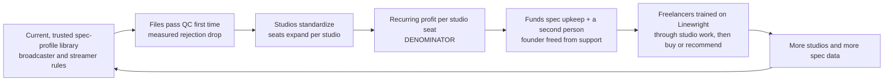

# Linewright: Good to Great

## One-screen verdict

**Hedgehog Concept (working hypothesis):** *Linewright makes a professional subtitle file pass its delivery spec the first time, and it grows by the studio seat.*

**Weakest link in the flywheel:** the step from proof to studio adoption. The claim that Linewright cuts QC rejections rests on two studio managers' unverified remarks. Your renewal rate mixes studios and individuals together, so you can't currently tell whether the part that compounds is healthy.

**Top three to stop:**
1. **Linewright Lite, the creator web app.** Decline it.
2. **The Linux port.** Not now.
3. **Leading with auto-align.** Stop selling it as the hero feature, and stop chasing a free tool on it.

**Most urgent brutal fact:** renewals have fallen four quarters in a row (64% → 58% → 55% → 52%). They are now below the 58% your own model said they would settle at, and you can't see whether individuals or studios are leaving. Meanwhile, the #1 reason people buy (auto-align, 69%) ships free in Lantern Subs stable "this winter."

**Missing numbers that would change this answer:**
- Studio-only renewal and net seat growth. If studios are also churning, the Hedgehog Concept weakens badly.
- Individual renewal by cohort, before and after the price rise.
- How each of the 39 studios found you.
- Support tickets split by segment.
- Whether any waitlist signup would actually pay $8.

Greatness potential: 30/100

*Evidence note:* this run had no research or memory access. Lantern's timeline, the creator-market size and competitor details come only from the dossier and are unverified. Every inference is marked `[ASSUMPTION]`.

---

## 1. The great version in one paragraph

Great Linewright is the tool a subtitle studio standardizes on so that every freelancer's file passes a broadcaster's or streamer's delivery spec the first time. Its library of spec profiles is maintained, versioned and trusted, and every release updates it, so the update plan and the subscription always buy something real. Individual professionals still buy it, because it is the fastest keyboard-driven way to deliver compliant work. Auto-align is table stakes, not the pitch. Revenue is mostly recurring and grows seat by seat inside studios that can show their QC rejections went down. It runs on at least two or three people, so the founder can take a month off and nothing breaks. It does not chase creators, platforms or Linux. It is narrow, and it is unusually hard to replace.

## 2. The Hedgehog Concept

| Circle | Candidates considered | Verdict |
|---|---|---|
| **Best in world at** | Auto-align | **No.** It is being commoditized: free in Lantern this winter, and speech models are everywhere. |
| | Cheaper than enterprise tools | **No.** That is a price position, not a "best at." |
| | Keyboard-only workflow | Strong, but too thin to carry the business alone. |
| | Creator captions | **No.** It is a crowded, platform-dominated market `[ASSUMPTION, unresearched]`, and nothing here gives you an edge. |
| | **Spec-compliance checking plus shared style profiles for professional delivery** | **Yes, in a narrow world.** Studios say this is why they buy. It draws on 11 years of subtitling expertise, and neither the cloud platform (weak editor) nor Lantern (no spec library) owns it. |
| **Economic engine: profit per ___** | Per individual license | Weak. It is one-time, depends on constant new acquisition, is exposed to Lantern, and likely drives most of the support load `[ASSUMPTION]`. |
| | Per renewal | It is blended and falling, so it is not yet a reliable engine. |
| | **Recurring profit per studio seat** | **Chosen.** $99 per seat per year, about 16 seats per studio on average, renewing, and expandable to 74+ seats in a single studio. Your accountant's "only part that compounds" points the same way. |
| **Passion** | Founder | The craft of professional subtitling, and frustration with clumsy or overpriced tools. You built this for subtitlers like you. |
| | Community | Forum regulars, and a Lisbon user who translated the whole UI for free. Professionals care about this tool. |

**Denominator:** recurring profit per studio seat. Individual professionals stay as the feeder and are measured separately.

**Confirmation tests (what would make this a PASS):**
- Studio seat retention is ≥ 90% when split out from individual renewals `[ASSUMPTION threshold]`.
- First-pass QC acceptance is measured in at least three studios, with a meaningful drop in rejections (≥ 30%) `[ASSUMPTION threshold]`.
- Studio seat count grows net over two quarters with no sales hire.
- At least some new studios can be traced back to freelancers who used Linewright.

**Does it explain past wins?** Yes. The studios that renewed cite the spec checker. **Does it rule things out?** Yes: creators, Linux, and an auto-align arms race. **Is it uncomfortable?** Yes. It turns down a 2,310-person waitlist and the "50x market."

## 3. The flywheel

**Does the loop close?** Logically, yes. Empirically, the B → C link (proof drives adoption) and the F → G link (freelancers bring in studios) are unmeasured.

**Current push (the next two turns):**
1. **Prove B.** Instrument per-studio QC reporting: rejection counts before and after, for files made in Linewright. Turn it into three to five studio case studies.
2. **Remove the C blockers.** Ship SSO, which three studios have asked for, and a minimal admin console. Leave out the salesperson for now.

**Doom-loop check:**

| Warning sign | Present? |
|---|---|
| Reacting without understanding | **Yes.** The price rise was modeled, the renewal rate missed the model, and the gap hasn't been investigated. |
| New direction after new direction | **At risk.** Four options are being "circled" at once. |
| A big program to jump-start momentum | **Yes.** The creator product is a six-month bet by the only developer to catch a "wave." |
| Inconsistency | **Yes.** The last two releases were bug fixes only, even though the update plan is sold on updates. |

## 4. The bus

| Person or commitment | Call | Note |
|---|---|---|
| **Founder** | **Keep, move seat** | Move from the support desk and bug triage to owning the spec library and studio relationships. |
| **Mac contractor** | **Keep, widen seat** | Candidate to fix the install and licensing flow and take on release engineering, which reduces the bus factor. |
| **Accountant** | **Keep** | Add monthly segment reporting: studio and individual renewals separately, by cohort. |
| **Lisbon translator** | **Keep** | Send her a lifetime license and public credit. She is a potential lead for a localization community. |
| **Forum regulars** | **Keep** | They are your early-warning system on Lantern. Ask them directly what would make them stay. |
| **Marisol, as product partner** | **Off the bus for this endeavor** | This says nothing about her or the relationship. Her opportunity is real, but it is a different business. Her incentives (revenue share, no build cost, "50x" framing) aren't aligned with Linewright's Hedgehog Concept. An affiliate link to the pro product is fine. |
| **Creator-product exploration** | **Off** | See the stop-doing list. |
| **Linux port** | **Off for now** | Revisit only if a paying studio requires it. |
| **Founder as support desk** | **Off** | About 30 tickets a week, mostly install and licensing, is a product defect plus a missing seat. |
| **Missing seat 1: part-time support and licensing** | **Fill first** | This is not a "when in doubt" hire. Your hours are the binding constraint. |
| **Missing seat 2: second engineer who can ship a release** | **Fill within 12 months** | Bus factor. Could be the Mac contractor expanded. |
| **Missing seat 3: studio success / sales** | **Wait** | Fill only after the case studies and the studio retention figure exist. When in doubt, don't hire. |

## 5. Stop-doing list

1. **Linewright Lite / the creator web app.** It is a different stack, a different customer and a different job. It is built on auto-align, the exact feature being commoditized, and it would take six months from the only developer while renewals slide. The 2,310 signups cost the people who signed up nothing.
2. **The Linux port.** 46 forum requests, none tied to studio revenue.
3. **Leading marketing with auto-align, and trying to out-accuracy free tools on it.** Keep it good enough. Sell spec compliance and keyboard speed.
4. **Shipping update-plan releases that are only bug fixes.** Every release must include at least one spec-profile or QC improvement.
5. **Clearing the 140-item backlog front to back.** Triage it against the Hedgehog Concept and close anything that doesn't trace to spec-pass or studio workflow.
6. **Answering install and licensing tickets yourself.** Fix the flow and delegate the rest.
7. **Changing prices without cohort measurement.**
8. **Building workflow or project-management features to match the cloud platform.** That is their circle, not yours.

**Non-negotiable disciplines:**
- Spec presets updated every release.
- Segment metrics reviewed monthly.
- Every new studio asked how it found you.

**Framework and freedom:**
- The support contractor can refund, reissue or extend licenses up to a set limit `[ASSUMPTION, e.g. one license or $129]` without asking.
- The Mac contractor owns the build and installer end to end.
- The founder decides what goes into the spec library and the roadmap.

**Bureaucracy check:** if the licensing system's activation limits exist mainly to deter piracy and generate most of the tickets `[ASSUMPTION]`, loosen them. The cost to honest professionals probably exceeds what piracy costs you.

## 6. Brutal facts and the faith statement

| # | Fact | Evidence | Severity | Owner |
|---|---|---|---|---|
| 1 | Renewals fell four quarters in a row and are below your own model | 64 → 58 → 55 → 52% vs. the 58% modeled | **High** | Founder |
| 2 | You can't see which segment is churning | The renewal rate blends individuals and studios | **High** | Founder + accountant |
| 3 | The #1 buy reason goes free this winter | Auto-align was cited by 69% of buyers; Lantern stable will ship it "this winter" | **High** | Founder |
| 4 | New-license units are down year over year, and seasonality doesn't explain a year-over-year drop | Q3 161 vs. 209 (−23%). "Summer is always slow" compares summer to summer | **High** | Founder |
| 5 | Bus factor of one | 50 h/week, 1 week off, one person holds the code and the spec knowledge | **High** | Founder |
| 6 | Revenue growth is partly price, not volume | +19.5% revenue while renewal price rose 26% ($39 → $49) and units fell | Medium | Founder |
| 7 | The update plan sells updates, but recent updates were bug fixes | Last two releases | Medium–High (a likely contributor to #1) `[ASSUMPTION]` | Founder |
| 8 | Studio value is anecdotal | Two unverified "more than half" quotes | Medium | Founder |
| 9 | Limited runway for hiring | About $88k banked vs. about $151k/yr in pay plus costs (≈ 7 months); about $60k/yr surplus | Medium | Founder |
| 10 | The creator-opportunity signal is cheap and its market sizing is the partner's own | Free waitlist; "50x" from Marisol's deck | Medium | Founder |
| 11 | Some concentration risk | The 74-seat studio ≈ $7.3k ≈ 11% of studio revenue | Low–Medium | Founder |

**Truth climate:** you are solo, so the risk isn't suppressed bad news from staff. It is self-explanation. Two misses (Q3 units, renewals) were explained by things outside your control (seasonality, "always going to cost some") instead of being investigated.

**Red-flag mechanism:** a monthly one-page segment dashboard. Any metric that misses its plan for two months running gets a written autopsy, not an explanation.

**Faith statement:** professional subtitlers and studios have to meet hard delivery specs every day. Free tools don't own that problem and cloud platforms don't serve it well. You have lived it for 11 years, and Linewright will prevail by being the one place where that knowledge is encoded and kept current.

## 7. Core ideology and the BHAG

**Core purpose:** to let subtitlers deliver work that is right the first time.

**Core values:**
1. Correctness over cleverness: a file that passes beats a feature that dazzles.
2. Respect the professional's time: keyboard-first, no friction.
3. Honest pricing: a one-time option stays, and there are no dark patterns.
4. Built by practitioners: the spec knowledge comes from doing the work.

**BHAG (10–15 year horizon):** "Passes Linewright" becomes how subtitle vendors prove delivery compliance to broadcasters and streamers. The industry's spec profiles live in Linewright.

**Clock-building mechanisms (Gate 9):**
- A versioned, documented spec-profile library with an update process someone else can run.
- A support runbook.
- A release checklist.
- Code-signing and build access held by a second trusted person (escrow).
- The segment dashboard.
- A two-week founder absence test each year.

## 8. Scorecard

| Output | Current | 12-month target | BHAG trajectory |
|---|---|---|---|
| **Studio seats on subscription** (the denominator's base) | 638 seats, 39 studios, ≈ $63.8k/yr | 800 seats `[ASSUMPTION target]` | Studio recurring revenue becomes most of total revenue; thousands of seats |
| **Renewal, split by segment** | 52% blended (Q3); split unknown | Studio seat retention ≥ 90%, individual ≥ 55%, blended no longer falling for 2 consecutive quarters `[ASSUMPTION targets]` | Studio net revenue retention > 100% |
| **First-pass QC acceptance for studio files** | Unmeasured; 2 anecdotes | Measured in ≥ 5 studios, 3 published case studies | An industry reference standard |

**Supporting metric:** founder-handled tickets per week, from about 30 to ≤ 10.

## 9. Next 90 days

| # | Action | Owner | Flywheel link |
|---|---|---|---|
| 1 | **Split the renewal data.** Separate studio and individual renewals by cohort, before and after the price rise. Call 10 lapsed individuals and every studio that churned or shrank. Do this in the first two weeks. | Founder + accountant | Protects D; tests the Hedgehog Concept |
| 2 | **Decline Linewright Lite in writing, warmly.** Offer Marisol an affiliate arrangement on the pro product if she wants one. Send the Lisbon translator a lifetime license and credit. | Founder | Removes the doom-loop risk |
| 3 | **Kill the support drain.** Fix the install and activation flow, and bring on a part-time support contractor (about 10–15 h/week) `[ASSUMPTION cost ≈ $15–25k/yr]`. | Founder + Mac contractor | Frees E |
| 4 | **Ship the studio release.** SSO, a minimal admin console, and per-studio QC rejection reporting. Recruit 3–5 studios to measure before and after. | Founder (+ contractor hours) | Proves B, unblocks C |
| 5 | **Reposition before Lantern stable ships.** Rewrite the individual pitch around spec QC and keyboard speed. Ship a spec-preset update so the update plan has visible value. | Founder | Defends F against fact #3 |

## 10. Re-check

If you'd like, I can set up a scheduled task for about 90 days out, after Q4 Year 0 renewals land. It would re-score the scorecard with real split-renewal and seat numbers and re-run Gates 1, 5 and 8 to confirm or break the Hedgehog Concept.

## 11. Risk register

| Source | Risk | Condition to clear, or early warning |
|---|---|---|
| Gate 2 (CONDITIONAL) | The founder is the single point of failure, and misses get attributed to outside causes | Cleared when a second person can ship a release and handle support during a two-week founder absence, and quarterly notes include a "mirror" paragraph on one missed metric |
| Gate 3 (CONDITIONAL) | Missing seats; support consumes the founder | Cleared when the support contractor is in place and founder tickets are ≤ 10/week |
| Gate 5 (CONDITIONAL) | The Hedgehog Concept is unproven | Cleared when studio retention is ≥ 90% split out and QC reduction is measured in ≥ 3 studios |
| Gate 8 (CONDITIONAL) | The B → C and F → G links are unmeasured | Cleared when case studies exist and new studios are attributed to a source |
| Decline 1: Hubris | "Studios renew, so they're locked in" | Warning: no studio exit interviews; renewal reasons unknown |
| Decline 2: Undisciplined more | Creator app, Linux, workflow features | Warning: roadmap items that can't be traced to spec-pass |
| Decline 3: Denial | Seasonality explaining year-over-year drops; the renewal model miss left unexamined | Warning: a third quarter of renewal decline explained rather than investigated |
| Decline 4: Grasping | Lantern ships, individual sales drop, and you jump to the creator app or a pricing overhaul | Warning: a six-month bet proposed to "make up" one bad quarter |
| Decline 5: Capitulation | Burnout leads you to sell or abandon the product | Warning: ≤ 1 week off per year, rising tickets, bug-fix-only releases |

## 12. Gate log

| Gate | Verdict | One line |
|---|---|---|
| 0 Fit | PASS | Ongoing product with a steward, resources, multi-year horizon and measurable outcomes |
| 1 Baseline | PASS | Good: $211.4k TTM, profitable, 39 studios. Growth is partly price, and units are down |
| 2 Level 5 Leadership | CONDITIONAL | Resolve and craft are strong; bus factor of one; misses attributed outward |
| 3 First Who | CONDITIONAL | Support seat missing; Marisol off the bus as product partner |
| 4 Brutal Facts | PASS | Renewal slide, Lantern auto-align and the unit decline are confronted; no contradiction of Gate 1 |
| 5 Hedgehog | CONDITIONAL | Spec-pass per studio seat; a working hypothesis pending split data |
| 6 Discipline | PASS | Eight stop-doing items, including the creator product |
| 7 Technology | PASS | Spec engine, profiles, SSO and reporting accelerate; auto-align is parity; Linux and the web app are irrelevant. Pioneer opportunity: versioned "spec-as-code" profiles and QC-rejection analytics |
| 8 Flywheel | CONDITIONAL | The loop closes; the proof link is unmeasured |
| 9 Built to Last | PASS | Purpose, values, a 10–15 year BHAG and clock mechanisms defined |
| 10 Mighty Fall | PASS | Five decline paths, each with a warning sign |

**Count:** 7 PASS, 4 CONDITIONAL, 0 FAIL. That is under half CONDITIONAL. All four share two root problems: **blended data hides whether the studio engine is healthy**, and **the founder is the only person who can do anything.** Fix those two and most of the conditions clear.