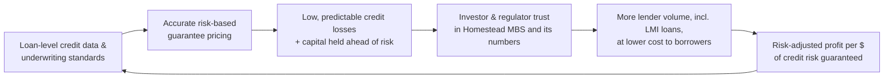

**Verdict: good, not great, and drifting toward decline.** Homestead's record is real: 16 years of double-digit operating-earnings growth and credit losses of 0.5 bp. But much of that record rests on a contested government privilege and on thin-capital leverage. It does not rest on a capability that is best in the world.

- **Hedgehog (working hypothesis):** Be the best in the world at pricing and standardizing U.S. conforming-mortgage credit risk, and earn risk-adjusted profit per dollar of credit risk guaranteed, on capital Homestead holds itself.
- **Weakest flywheel link:** trust in Homestead's numbers.
- **Top 3 stop-doing:** (1) managing to the $6.46 EPS goal and paying on it; (2) growing the retained portfolio faster than capital; (3) leading with "operating" earnings.
- **Most urgent brutal fact:** only $0.9B of capital above the legal minimum on an $887B balance sheet, just after a −14-month duration gap and the regulator's first-ever supervisory action.
- **Numbers that would change this:** the earnings split between guarantee and portfolio businesses, the fair value of hedges, amortization policies, and the credit profile of recent purchases.

Greatness potential: 20/100

---

## 1. The great version in one paragraph

Great Homestead is the conforming mortgage market's **credit-risk utility**. It knows more than anyone about how U.S. mortgages perform, and it prices every guarantee for the risk it carries. It holds capital it chose itself, well above the legal minimum. It reports one set of numbers that investors and regulators can take at face value. Its mission ("homes families can keep") and its profits point the same way, because LMI loans are priced and underwritten rather than bought to hit a quota. Its retained portfolio is a tool for market liquidity, not an engine for hitting earnings targets. Its funding advantage comes more and more from its own capital and record, and less from an assumed government backstop. That is the only version of greatness that survives a political debate Homestead does not control.

## 2. The Hedgehog Concept

**Sentence (working hypothesis):**
*Homestead is the best in the world at pricing and standardizing U.S. conforming-mortgage credit risk so more low- and moderate-income families can own homes they keep. It earns its living per dollar of credit risk guaranteed, backed by its own capital.*

| Circle | Candidates considered | Kept | Ruled out, and why |
|---|---|---|---|
| **Best in world at** | (a) Cheapest funding of mortgages; (b) managing interest-rate risk on a huge portfolio; (c) pricing and standardizing mortgage credit risk; (d) political advocacy for housing | **(c)**: 0.5 bp credit losses, a share of the conforming market (~26% of all U.S. residential mortgage debt held or guaranteed) that yields unmatched loan-level data, and underwriting standards set across the market | (a) comes from the **charter**, not from skill; anyone with the charter could do it. (b): the evidence says *not* best, given the −14-month gap and the supervisory action. (d) is a defensive activity, not a capability. |
| **Economic engine** | Profit per $ of retained portfolio (the current engine); profit per loan; risk-adjusted profit per $ of credit risk guaranteed | **Risk-adjusted profit per dollar of credit risk guaranteed** (denominator) | Profit per $ of portfolio rewards size funded by a subsidy and adds rate risk. Profit per loan ignores risk. |
| **Passion** | Expanding home ownership; growth and EPS; capital-markets sophistication | **Expanding *sustainable* home ownership**, especially for LMI families [ASSUMPTION: the stated mission reflects real staff passion] | EPS growth is a scoreboard, not a passion. Treating it as one is the current problem. |

**Uncomfortable implications.** The portfolio business is probably the larger earnings engine, and it sits mostly **outside** the Hedgehog [ASSUMPTION: the split is not in the dossier]. The Hedgehog also implies slower reported growth in the year the EPS goal would pay out.

**Confirmation tests:**
1. Disclosed segment data show the guarantee business earns attractive returns on its own capital.
2. Guarantee fees priced for risk hold volume when sold on Homestead's record.
3. LMI loans bought under the 50% goal perform within priced loss expectations.

## 3. The flywheel

The loop closes: profit is retained as capital and reinvested in data and capacity, which brings more volume and more data.

**Weakest link: D (trust).** Reported earnings fell 22% while operating earnings rose 21%. The company asks investors to look past the gap. Capital sits near the minimum, and the regulator has acted for the first time. Trust is what turns low losses into cheap, durable funding on Homestead's own name.

**Current push (next 1–2 turns):**
1. Make the numbers trustworthy. Report GAAP first, and get an independent review of accounting policy.
2. Build capital ahead of growth, so link C actually holds.

**Doom-loop check: present in the current model.**

`Public EPS promise → grow the retained portfolio on near-Treasury funding → more rate and prepayment exposure → hedging → GAAP volatility → redefine earnings as "operating" → target looks on track and bonuses pay → bigger promise`

A second loop runs alongside it: `scale → political criticism → mission rhetoric as defense → more growth to fund the mission`.

The signs match the doom loop. Momentum is pushed by an external promise rather than by the loop's own logic. Growth comes from the single lever that is subsidized. Metrics get redefined when results disappoint.

## 4. The bus

| Seat | Call | Rationale |
|---|---|---|
| **CEO** (4 yrs; ex-vice chair, ex-federal budget official) | **Keep, on one condition** | His Washington knowledge is valuable for a politically exposed firm. He set the EPS goal tied to his own pay. Publicly retiring it is the Level 5 test (Gate 2). [ASSUMPTION: no direct evidence on humility or ambition beyond the goal itself] |
| **COO** (3 yrs; ex-industrial finance arm, ex-military) | **Keep; aim at operating discipline** | His background suggests process rigor [ASSUMPTION]. Point him at credit-risk infrastructure and the LMI underwriting quality behind the 50% goal. |
| **CFO** (long-serving insider) | **Move seat (narrow it)** | Today one EPS-incentivized seat appears to own both the accounting choices that define "operating earnings" and the interest-rate hedging [ASSUMPTION about scope]. The issue is the seat's design, not the person. Keep reporting and funding; move risk measurement and chief-accounting authority elsewhere. |
| **Independent Chief Risk Officer** reporting to the board | **Missing** | Nobody in the dossier owns risk independently of the earnings goal. |
| **Chief Accounting Officer / Controller** with a direct line to the audit committee | **Missing** | Needed for a credible GAAP-first posture. |
| **Board members with deep rate-risk and accounting expertise** | **Missing** [ASSUMPTION: board composition unknown] | To oversee the items above. |
| **Public EPS-doubling goal** (a commitment, not a person) | **Off** | It drives the doom loop. |
| **EPS-only pay formula and company-wide EPS-vesting grant** | **Off; replace, don't confiscate** | Rank-and-file employees did not design the target. Convert their grant to a time- or mission-based award so they are not penalized by the reset. |

## 5. Stop-doing list

1. **Stop managing to the $6.46 EPS goal.** Withdraw it as a management target. EPS needs only +2.4% from $6.31 to trigger a binary, company-wide vesting, and that is exactly the kind of threshold that invites managing the number.
2. **Stop paying executives on EPS alone.** Move to multi-year, risk-adjusted measures (capital, credit losses against priced expectations, GAAP results) with clawbacks.
3. **Stop growing the retained portfolio faster than core capital.** The portfolio grew 13–16% a year while capital stayed at ~3.2% of assets.
4. **Stop treating the legal minimum as the capital target.** The $0.9B surplus is about 0.1% of assets and about 20% of one year's GAAP income.
5. **Stop leading with "operating" earnings.** Report GAAP first, then an audited reconciliation.
6. **Stop letting the duration gap drift outside a hard band** to protect spread income [ASSUMPTION: cause of the August gap unknown].
7. **Stop buying loans to hit goal counts before their risk is priced.** "Homes families can keep" is the mission. Volume alone is not.
8. **Stop answering critics with mission rhetoric in place of capital and transparency.**

**Non-negotiable disciplines (fanatical consistency):**
- Price every guarantee for its risk.
- Hold capital ahead of growth.
- Report the same way every quarter, good or bad.
- Escalate every limit breach to the board within days.

**Framework (freedom within):** The board sets capital, duration and credit-pricing limits. Inside those limits, business teams are free to design products, pricing and lender programs.

**Bureaucracy check:** The new external supervision is a rule-layer compensating for a missing internal seat, the independent risk officer. Fill the seat, and over time the outside oversight becomes confirmation rather than correction.

## 6. Brutal facts and the faith statement

| # | Fact | Evidence | Severity | Owner |
|---|---|---|---|---|
| 1 | The economic engine rests on a **contested implicit government backstop** | Borrowing near Treasury rates; a Treasury official testified on a bill repealing the credit lines; critics question the structure | Critical | CEO / Board |
| 2 | **Capital is thin** | $28.1B core capital = 3.2% of assets (about 31× leverage); $0.9B over the minimum; capital is about 1.5% of the $1.82T book of business | Critical | CFO → CRO |
| 3 | **Interest-rate risk escaped its band** | Duration gap of −14 months in August; first-ever formal supervisory action in September | High | CFO / Treasurer → CRO |
| 4 | **Headline earnings and reported earnings diverged** | Operating $6.39B (+19%) vs GAAP $4.62B (−22%). The $1.77B gap is 28% of operating income. Over two years, cumulative GAAP trails operating by about $1.25B | High | CFO / Audit committee |
| 5 | **Pay is wired to the target** | Executive bonuses and long-term awards tied to EPS; company-wide grant vests on $6.46 | High | Comp committee |
| 6 | **Growth outruns the market it serves** | The EPS goal implied ~15% a year against slower mortgage-market growth; Homestead already holds 11% of all U.S. residential mortgage debt | Medium-High | CEO |
| 7 | **Sixteen years of smooth double-digit operating growth in a rate-sensitive spread business** deserves an independent look. Smoothness is not proof of a problem, but it is a reason to examine amortization and hedge policies | Rate cycles and refinancing waves occurred; operating growth stayed between 14% and 21% each year | Medium-High | Audit committee |
| 8 | **Credit risk of goal-driven purchases is unknown** | The 50% LMI goal is rising; the credit profile by product is not disclosed | Medium (unknown) | COO |
| 9 | **The "hole if it vanished" is partly fillable** | A sister enterprise with a similar charter competes | Medium | CEO |

**Truth climate:** There is a public promise, pay is tied to it, the company keeps saying "on track," and it asks investors to look past the losses. That is a climate where bad news travels slowly [ASSUMPTION: internal debate norms unknown]. The regulator's action is the clearest red flag so far. Treat it as information, not politics.

**Faith statement:** *America needs a deep, standardized market for mortgage credit, and Homestead can earn an honest, durable living providing it on its own capital, with numbers anyone can trust.*

## 7. Core ideology and the BHAG

- **Core purpose:** Make home ownership possible and sustainable for American families by keeping fairly priced mortgage credit available through every cycle.
- **Core values:**
  1. Homes families can keep.
  2. Numbers that mean what they say.
  3. Safety and soundness before growth.
  4. A public privilege is held in trust.
- **BHAG (20-year):** Homestead's guaranteed securities trade near Treasury prices because of Homestead's own capital and record, not an assumed backstop.
- **Clock-building mechanisms:**
  - A board-set capital policy above the statutory minimum.
  - A rule that the portfolio grows no faster than capital.
  - An independent CRO and chief accounting officer.
  - GAAP-first reporting.
  - Multi-year pay with clawbacks.
  - Automatic board escalation of any limit breach.

## 8. Scorecard

| Output | Current (Year −1) | 12-month target | BHAG trajectory |
|---|---|---|---|
| Core capital surplus over the legal minimum | $0.9B (3.2% of assets) | ≥ $4B [ASSUMPTION], built from retained earnings and slower portfolio growth | Capital set by Homestead's own stress tests, enough to fund on its standalone strength |
| Months with duration gap outside the policy band | At least 1 known (−14 months, August); band unknown [ASSUMPTION ±6 months] | 0 | Refinancing waves become non-events |
| GAAP net income, and share of it from the guarantee business | $4.62B (−22%); share **unknown** | Split disclosed; audited reconciliation to operating; guarantee share rising | Majority of profit from risk-priced guarantees |

## 9. Next 90 days

| # | Action | Owner |
|---|---|---|
| 1 | Withdraw the EPS-doubling goal as a pay trigger. Redesign executive pay to multi-year risk-adjusted metrics with clawbacks. Convert the company-wide grant so rank-and-file employees aren't penalized. | Comp committee chair + CEO |
| 2 | Commission an independent outside review of amortization, hedge accounting and the definition of "operating earnings," reporting directly to the board. | Audit committee chair |
| 3 | Appoint an independent Chief Risk Officer reporting to the board, and separate the chief accounting role from the CFO. | Board chair + CEO |
| 4 | Adopt a capital and risk policy: the portfolio grows only as fast as core capital; a hard duration band with escalation; a surplus target. | CFO + new CRO |
| 5 | Resolve the supervisory action through an agreed, public remediation plan. Publish the earnings split between guarantee and portfolio businesses. | CEO |

## 10. Re-check

I can set up a scheduled task about 90 days out. It would re-score the scorecard with real numbers and re-run Gates 1, 5 and 8, especially whether the guarantee business can carry the engine.

## 11. Risk register

**Open CONDITIONAL items:**

| Gate | Condition | Evidence that turns it to PASS |
|---|---|---|
| 1 | Is "good" real on a GAAP and economic basis, or only on "operating" earnings? | Independent accounting review clears the policies; segment split disclosed |
| 2 | Is leadership ambition aimed at the institution or at the number? | CEO publicly retires the EPS goal and pay is redesigned |
| 3 | Risk and accounting authority are concentrated in an EPS-incentivized seat; key seats are missing | CRO and chief accounting officer appointed with board reporting lines |
| 4 | The truth climate is unverified and the red flags are external | Board-level escalation mechanism working; supervisory remediation accepted |
| 5 | The Hedgehog depends on the guarantee business standing on its own | Segment returns on allocated capital are attractive; LMI loans perform to priced expectations |
| 10 | Stage 2–3 decline signals are present | Capital surplus rising, duration within band, GAAP-first reporting for 4 quarters |

**Decline-risk register (Gate 10):**

| Stage | How Homestead could slide (or is sliding) | Early warning sign |
|---|---|---|
| 1. Hubris | 16 years of double-digit growth used as proof that scrutiny is unnecessary | Critics dismissed as "political"; the record cited instead of the data |
| 2. Undisciplined pursuit of more | **Present.** EPS doubling goal; portfolio up 13–16% a year; 11% of all U.S. residential mortgage debt held | A growth target set before capital capacity |
| 3. Denial of risk and peril | **Signals present.** Capital near the minimum; −14-month gap; first supervisory action; "well hedged / minimal credit risk"; investors asked to look past GAAP losses | Metrics redefined so bad numbers don't count; regulator findings contested rather than fixed |
| 4. Grasping for salvation | If the charter is challenged or capital is hit: big new business lines, a lobbying blitz, aggressive accounting, or a savior CEO | A dramatic new strategy announced under pressure |
| 5. Capitulation | Loss of special status, or a capital shortfall forcing outside intervention | Capital below the minimum; debt no longer priced near Treasuries |

**Read:** Homestead is in Stage 2 with Stage 3 signals. By Collins's account, that is still a recoverable position, but only if the denial stops now.

## 12. Gate log

| Gate | Verdict | Note |
|---|---|---|
| 0 Fit | PASS | Ongoing listed business; board and CEO steward; decades-long horizon; measurable |
| 1 Baseline | CONDITIONAL | Good, not yet great. Strong scale and credit record. Earnings quality is unverified, and endurance depends on a contested charter. Not "already great": stewardship mode rejected |
| 2 Level 5 Leadership | CONDITIONAL | A public EPS promise tied to own pay |
| 3 First Who | CONDITIONAL | Missing CRO and CAO; CFO seat concentrated |
| 4 Brutal Facts | CONDITIONAL | Facts are severe but consistent with a baseline built on both GAAP and operating figures, so no loop-back needed; truth climate unverified |
| 5 Hedgehog | CONDITIONAL | Credit-risk-guarantor hypothesis; portfolio engine falls outside it |
| 6 Discipline | PASS | Eight stop-doing items; limits framework defined |
| 7 Technology | PASS | See tech triage below |
| 8 Flywheel | PASS | Proposed loop closes; current doom loop flagged |
| 9 Built to Last | PASS | Ideology, BHAG and mechanisms set |
| 10 Mighty Fall | CONDITIONAL | Stage 2 present, Stage 3 signals |

**Tally (counted from the table):** 5 PASS, 6 CONDITIONAL, 0 FAIL. More than half are CONDITIONAL. Two root causes explain most of them:
- **(A)** An earnings engine built on a contested public subsidy plus thin-capital leverage.
- **(B)** An incentive and reporting system anchored to a public EPS promise, which makes it hard to see how much risk that engine runs.

**Evidence note:** This session had no memory, past chats or web search. No prior run was available, and Gate 4 market and competitor research was not possible. The question batch was skipped because this was an autonomous run, so the dossier is the only evidence and every inference is marked `[ASSUMPTION]`. Collins's caveat applies: these are disciplined hypotheses to test, not guarantees.

---

### Appendix: supporting gate artifacts

**Subject card (Gate 0):**
- **Name:** Homestead Mortgage Association
- **Type:** Business (shareholder-owned, congressionally chartered)
- **Steward:** CEO and board
- **Horizon:** decades
- **Stage:** mature, high-growth, under regulatory and political pressure

**Baseline sheet (Gate 1):**
- **Evidence of good:**
  - Operating earnings rose from $3.42B to $6.39B, about 17% a year compounded.
  - Book of business is $1.82T (+16%).
  - Credit losses are 0.5 bp.
  - $670B toward the $2T underserved commitment in Year −1.
- **Against:**
  - GAAP net income fell from $5.89B to $4.62B.
  - Capital is 3.2% of assets.
  - A supervisory action is open.
- **Great tests:**
  - *Superior performance:* yes on operating results; unproven on a risk-adjusted basis.
  - *Distinctive impact:* large, but a sister enterprise shares it.
  - *Endurance:* hinges on a charter privilege under debate. Not yet met.

**Leadership read (Gate 2):**
- **Strengths:** deep policy and budget experience; clear mission language.
- **Gaps:** a personal, public numeric promise tied to pay, plus a habit of reframing earnings. Window and mirror behavior is unknown [ASSUMPTION].
- **One behavior change:** publicly retire the EPS goal in the year it would pay out, and credit the regulator's findings rather than contest them.

**Tech triage (Gate 7):**

| Technology | Class |
|---|---|
| Automated underwriting and loan-level credit models | **Accelerates** (pioneer candidate) |
| Book-wide loan-performance analytics | **Accelerates** (pioneer candidate) |
| Derivatives and hedging infrastructure | Parity; must be bulletproof |
| Hedge-accounting and amortization systems | Parity; critical to trust (link D) |
| Fear- or hype-driven adoption | None evident in the dossier |