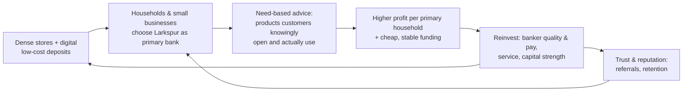

# Good to Great: Larkspur Financial

## Verdict

**Good, not yet great.** Larkspur has a strong franchise, but its main yardstick has never been verified, and staff pay is tied to that yardstick.

- **Hedgehog (working hypothesis):** Be the bank American households and small businesses choose as their *primary* financial home, and earn more profit per primary relationship because customers chose to deepen it, not because they were sold.
- **Weakest flywheel link:** the step from need-based advice to products customers actually use. Quotas can raise the product count without making the relationship any deeper.
- **Top three stop-doing items:**
  1. Daily and monthly product-count goals in the stores.
  2. Incentive pay based on products sold.
  3. Promoting "eight products per household" as the goal.
- **Most urgent brutal fact:** a regulator has already found that quotas and incentive pay allegedly fostered misconduct in one subsidiary. The same mechanism drives the core retail bank.
- **Missing numbers that would change this answer:**
  - the share of cross-sold accounts that are active or funded
  - terminations and hotline reports related to sales integrity
  - turnover among store staff
  - how sales goals are set

Greatness potential: 55/100

---

## 1. The great version in one paragraph

Great Larkspur is the bank one in three American households names as its *primary* bank. Today it only *serves* that many. Every product a household holds is one it opened knowingly and uses. Profit per primary household beats peers because deposits are cheap and stable, credit is disciplined, and customers bring in more of their business on their own. Store bankers are paid for customer outcomes, such as active and funded relationships, satisfaction and retention, not for product counts. Business lines keep their autonomy. Risk, conduct and HR data, however, flow to an independent center that can see a problem in one unit before it spreads. The bank's crisis-proven conservatism becomes a trust advantage that compounds, instead of a reputation the sales system slowly spends.

## 2. The Hedgehog Concept

**Sentence:** *Be the primary everyday bank for American households and small businesses, earning more profit per primary relationship because customers chose to deepen it.*

| Circle | Candidates considered | Kept | Ruled out |
|---|---|---|---|
| **Best in the world at** | Cross-selling; mortgage volume; CRE lending; dense store network; low-cost core deposits; Main Street small-business banking; credit discipline through cycles | Low-cost core-deposit franchise plus store density plus credit discipline, applied to everyday household and small-business banking | **Cross-selling itself** (a tactic, and its quality is unverified). **Mortgage origination rank** (size is a position, not best-in-world economics; it is cyclical and carries consent-order liability). **Largest CRE lender** (size is not superiority; it is a concentration risk). **Capital markets** (no evidence it can beat specialist banks there). |
| **Drives the economic engine** | Products per household; net income; deposits per store; profit per household; profit per *primary* household | **Economic profit per primary household**, meaning households with primary checking and active use | Products per household. It is an input that can be raised by opening accounts nobody uses, so it does not reliably drive profit. |
| **Deeply passionate about** | The community-banking culture; "stores" and "team members"; serving customers' full needs; decentralization and ownership | Serving customers' full financial needs; ownership culture | The passion for *the number eight*. If the passion is really for the metric rather than the customer, this circle fails. That is untested. |

**Denominator:** economic profit per primary household. A primary household has its main checking or operating account here and actively uses the products it holds.

**Confirmation tests (what evidence would confirm the hypothesis):**
1. Households classed as primary are materially more profitable and more durable than non-primary households holding the same product count `[ASSUMPTION: likely, not shown]`.
2. Active-product cross-sell explains past earnings outperformance better than raw cross-sell does.
3. Removing product quotas in a pilot region does not reduce primary-household growth or profit per household within 12 months.

**Uncomfortable to commit to?** Yes. It means de-emphasizing the company's signature metric and its most celebrated sales machine.

## 3. The flywheel



**Weakest link: C.** The current system rewards the *count* of products, not whether customers need and use them. If C is driven by quotas, the loop does not close through trust (F). It closes through pressure, and pressure is a doom loop, not a flywheel.

**Current push (next one or two turns):**
1. Turn C into something verifiable. Measure active and funded products, and pay on that.
2. Make F visible. Track complaints, customer-confirmed account openings, and trust scores at store level.

**Doom-loop check: a hidden doom loop is present.**

```
Earnings pressure (integration savings ending, low rates)
  → higher product goals in the stores
  → pressure to hit goals → possible low-quality or unwanted accounts
  → reported cross-sell keeps rising
  → management reads it as proof the strategy works
  → higher goals …
```

| Doom-loop sign | Present? |
|---|---|
| Reaction without understanding | Possible. The cross-sell number is managed without activity data. |
| New direction after new direction | No. Strategy has been consistent. That is a strength. |
| Big acquisition to jump-start momentum | Risk ahead. Integration savings are ending, which is the classic setup for the next deal. |
| Inconsistency | No. |

## 4. The bus

| Person / commitment | Call | Reasoning |
|---|---|---|
| CEO and chairman | **Keep, with a governance change** | Deep culture knowledge and long tenure. Combining the chair and CEO roles concentrates authority, so the board should name a strong lead independent director or separate the roles. |
| Head of Community Banking | **Keep, seat redefined; decision rests on evidence** | Her success is measured on the metric now under question. Redefine the seat around primary households and conduct outcomes. The cross-sell quality audit, not this dossier, should decide anything further. |
| Risk managers inside business lines | **Move seat** | Change their primary reporting line to a central Chief Risk Officer with authority across lines. |
| HR inside business lines | **Move seat** | Data on terminations, hotline reports and turnover goes centrally to the board. |
| Store team members | **Keep** | The system comes first. Fix the incentives before judging the people inside them. |
| Mortgage leadership | **Keep, with remediation mandate** | Consent orders and the fair-lending suit make remediation their first priority. |
| Board audit, risk and compensation committees | **Keep, but take ownership** | Conduct risk and incentive design become explicit board responsibilities. |
| Commitment: "eight products per household" goal | **Off the bus** | It ties the culture to a count rather than to customers. |
| Commitment: product-based store incentive plans | **Off the bus** | Replaced by pay based on outcomes. |
| **Missing:** central CRO with cross-line authority | **Hire / appoint** | Under decentralization, no one outside the units that earn the revenue can see conduct risk. |
| **Missing:** head of conduct and sales-practice surveillance | **Hire** | This seat owns anomaly detection. |
| **Missing:** customer-outcomes and complaints lead | **Hire / appoint** | This seat owns the trust step (F) in the flywheel. |
| **Missing:** succession bench for CEO and retail head | **Build** | Both roles carry long-tenured, concentrated knowledge. |

## 5. Stop-doing list

1. **Stop** setting daily and monthly product-count sales goals for store staff.
2. **Stop** tying incentive pay to the number of products sold or to raw cross-sell.
3. **Stop** promoting "eight products per household" internally and externally as *the* goal.
4. **Stop** counting unfunded or inactive accounts in reported cross-sell.
5. **Stop** treating risk management and HR data as business-unit property. Autonomy stays; invisibility goes.
6. **Stop** measuring mortgage and CRE success by market rank or volume `[ASSUMPTION: rank is currently a management focus, as the dossier's emphasis on "largest" suggests]`.
7. **Stop** treating the subprime finding as a closed legacy matter at a former subsidiary, without checking whether the same mechanism operates in the core bank.
8. **Refuse in advance:** a large acquisition whose main purpose is to replace fading integration savings.

## 6. Brutal facts and the faith statement

| # | Brutal fact | Evidence | Severity | Owner |
|---|---|---|---|---|
| 1 | A regulator found that incentive pay and sales quotas allegedly fostered steering and falsified applications. The same tools (product goals, pay on product sales) run the core retail bank. | Central-bank fine of $85M (Year −1). Store goals and incentive design as described in the dossier. | **Critical** | CEO, board comp committee |
| 2 | Cross-sell is reported without any data on whether the products are active or funded, so leadership cannot tell real relationships from paper accounts. | Usage data is absent from the dossier. Cross-sell rose every quarter. | **Critical** | CFO, central CRO |
| 3 | Moving from 5.92 to 8 products is about a 35% increase per household. A goal of that size, cascaded into daily store targets, creates strong pressure on a very large front line. | 5.92 reported against a goal of 8. About 264,000 team members and more than 9,000 stores. | High | Head of Community Banking |
| 4 | Decentralized risk and HR mean conduct problems can stay inside the unit that profits from them. | Dossier's description of how functions are organized. | High | CEO, board risk committee |
| 5 | The basic red-flag data (terminations, hotline reports, turnover) is not part of what leadership has put forward. | Absent from the dossier. | High | Central HR, board audit committee |
| 6 | Earnings growth faces headwinds: integration savings are ending, rates are low, and the mortgage engine is cyclical. Pressure to make the numbers lands on the stores. | Integration completed last October. Dossier's open questions. | Medium–High | CEO, CFO |
| 7 | The largest business line carries regulatory heat: servicing consent orders and a reverse-redlining suit. | April consent orders; state attorney general lawsuit. | Medium–High | Head of Mortgage, General Counsel |
| 8 | Success conditions favor hubris: record earnings, the most valuable U.S. bank, and public praise from a famous investor. | Year −1 results; investor letter. | Medium | Board |
| 9 | Being the largest CRE lender is a concentration risk, not proof of excellence. | Market-position data. | Medium | Wholesale head, CRO |

**Truth climate:** unknown. Decentralization plus a celebrated metric is a setting where bad news travels slowly upward. No red-flag mechanism that reaches the board is visible.

**Charisma check:** there is no evidence of a suppressive personality. The risk here is institutional, not personal. A long-tenured leader who built the culture may find it hardest to see its flaws.

**Faith statement:** Larkspur's deposit franchise, its reach into one in three households and its crisis-tested credit discipline are rare and real. A bank that earns its relationships honestly will compound faster and longer than one that counts them.

## 7. Core ideology and the BHAG

**Core purpose:** Help households and businesses succeed financially.

**Core values (preserve):**
1. The customer's real need comes before any number.
2. Integrity is non-negotiable. No goal justifies a product the customer didn't knowingly choose.
3. Ownership. Decentralized leaders own outcomes, inside guardrails set centrally.
4. Conservative strength. A durable balance sheet and disciplined credit.
5. Team members are the franchise.

**BHAG (20-year horizon):** Become the bank that one in three American households *names as its primary bank*, not merely one it serves, and the one they trust most.

**Mechanisms (clock building):**
- A central conduct-surveillance function with board reporting, flagging anomalies such as accounts opened and never used, account clusters by employee, and complaint spikes.
- An incentive design rule: pay only on outcomes the customer confirms or uses, with clawback for conduct breaches.
- Customer confirmation of every new account `[recommendation]`.
- A quarterly board review of hotline, termination, turnover and complaint data, broken down by business line.
- A lead independent director or separate chair, plus a named succession bench for the CEO and the heads of business lines.

## 8. Scorecard

| Output | Current value | 12-month target | BHAG trajectory |
|---|---|---|---|
| **Primary households** (share of retail households with primary checking and active use) | Unknown. "Serves 1 in 3 households" is *served*, not primary. | Publish a verified baseline; grow from it `[target to be set after baseline]` | One in three U.S. households name Larkspur as primary |
| **Active cross-sell** (products used or funded in the last 90 days, per household) | Unknown. The reported unadjusted figure is 5.92. | Publish an audited active figure and the gap to 5.92; shrink the gap while active cross-sell grows | Active cross-sell is the only cross-sell reported |
| **Conduct health index** (complaints per 10k households, sales-integrity terminations, store team-member turnover) | Unknown (not in the dossier) | Baseline established and reported to the board; improving trend | Industry-best trust and complaint ratios |
| *Guardrails (not scored)* | Net income $15.9B; Tier 1 common 9.46% | Keep capital strength comfortably above requirements `[ASSUMPTION]` | — |

## 9. Next 90 days

| # | Action | Owner | Flywheel step pushed |
|---|---|---|---|
| 1 | Commission an independent audit of cross-sell quality. Sample new accounts across regions for activity, funding and customer consent, and report results to the board audit committee. | Board audit committee with an external firm | C |
| 2 | Pull sales-integrity terminations, ethics-hotline reports, complaints and store turnover from every business line into one central view, broken down by region and store. | Interim central CRO, General Counsel | C, F |
| 3 | Suspend daily product quotas in two pilot regions. Pay those regions on active relationships, satisfaction and retention, and compare against control regions. | CEO, Head of Community Banking, board comp committee | C |
| 4 | Charter a central conduct-risk function with authority across business lines, plus a reporting line to the board risk committee. Begin the search for a permanent CRO. | CEO, board risk committee | E, F |
| 5 | Stop promoting the eight-products goal. Prepare to report primary households and active cross-sell from the next annual cycle. | CFO, Head of Investor Relations | B, D |

## 10. Re-check

I can set up a scheduled re-check about 90 days from now. It would re-score the scorecard using the audit's real numbers and re-run Gate 1 (baseline), Gate 5 (Hedgehog) and Gate 8 (flywheel). Scheduling isn't available in this session, so this is an open offer to set up later.

## 11. Risk register

| Source | Risk / open condition | Evidence that resolves it |
|---|---|---|
| Gate 1 (C) | Cross-sell can't count as evidence of "good" until it is verified | Audited share of active and funded cross-sold products |
| Gate 2 (C) | Unclear whether the CEO looks in the mirror about the subprime finding or treats it as an isolated legacy issue | A public or board-level statement that reviews the core retail incentive system in light of the finding |
| Gate 3 (C) | No central risk or conduct seat; the retail head's seat depends on audit results | CRO appointed with cross-line authority; audit outcome reviewed |
| Gate 4 (C) | Truth climate unknown; no red-flag mechanism reaches the board | First quarterly board review of hotline, termination and turnover data |
| Gate 5 (C) | Hedgehog denominator not yet measurable | Profit per primary household computed and compared with non-primary households |
| Gate 6 (C) | Quotas and product-based pay still in force | Pilot results; board approval of a redesigned incentive plan |
| Gate 8 (C) | Loop closes only if step C is need-based | Active-cross-sell trend holding as quotas come off |
| Gate 10 | Decline risks, see below | Early-warning signs monitored quarterly |

**Decline-risk register (Gate 10):**

| Stage | How Larkspur could slide | Early warning sign |
|---|---|---|
| 1. Hubris born of success | Believing its crisis performance and the investor's praise prove the sales system is sound | Leadership citing rank or market value in response to conduct questions |
| 2. Undisciplined pursuit of more | Chasing eight products per household, the top mortgage rank and the top CRE rank all at once | Goals rising faster than active usage; growth in CRE concentration |
| 3. Denial of risk and peril | Treating the subprime fine, consent orders and lawsuit as separate legacy events | Red-flag data kept inside business lines; no root-cause review of incentives |
| 4. Grasping for salvation | A large acquisition or deep store cost cuts to replace fading integration savings | Deal talk framed around earnings accretion rather than primary households |
| 5. Capitulation | Trust collapses after a systemic conduct failure, bringing regulatory limits on growth | Regulatory restrictions on growth or business activities; sustained loss of primary households |

## 12. Gate log

Evidence note: there was no search, memory or prior-run lookup in this session. Market and competitor research for Gate 4 was not done, so this run rests on the dossier alone.

| Gate | Verdict | One line |
|---|---|---|
| 0 Fit | PASS | Ongoing, stewarded, multi-year, measurable. Business type; CEO and chairman is steward; mature stage following integration. |
| 1 Baseline | CONDITIONAL | Good is proven on earnings, capital and crisis resilience. Cross-sell was excluded as evidence until verified. |
| 2 Level 5 | CONDITIONAL | Resolve and culture are evident; the mirror test on incentive-driven misconduct is unproven; chair and CEO roles combined. |
| 3 First Who | CONDITIONAL | No central risk or conduct seat; retail head's seat redefined pending audit. |
| 4 Brutal Facts | CONDITIONAL | Facts are severe but consistent with Gate 1 because cross-sell was already excluded. Truth climate unknown. |
| 5 Hedgehog | CONDITIONAL | Real intersection found (primary bank, profit per primary household); denominator not yet measured. |
| 6 Discipline | CONDITIONAL | Stop-doing list is clear; quotas and product-based pay still active. |
| 7 Technology | PASS | Digital banking and account-activity analytics accelerate the Hedgehog; count-based sales tracking is to be dropped. |
| 8 Flywheel | CONDITIONAL | Loop closes only if step C is need-based; a hidden pressure doom loop was flagged. |
| 9 Built to Last | PASS | Ideology, BHAG and clock-building mechanisms defined. |
| 10 Mighty Fall | PASS | Decline register built; Stage 1 signs already visible. |

**Tally: 4 PASS, 7 CONDITIONAL, 0 FAIL.** More than half the gates are CONDITIONAL. Two shared root problems explain nearly all of them:

1. **The core metric is unverified and tied to pay.** Cross-sell drives Gates 1, 5, 6 and 8.
2. **Decentralized control hides conduct data from anyone outside the earning unit.** This drives Gates 2, 3 and 4.

Fixing these two problems, through the audit and the central conduct function, would likely turn most of the CONDITIONALs into PASSes.